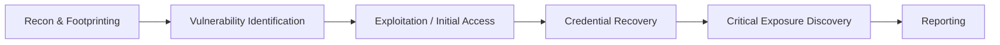
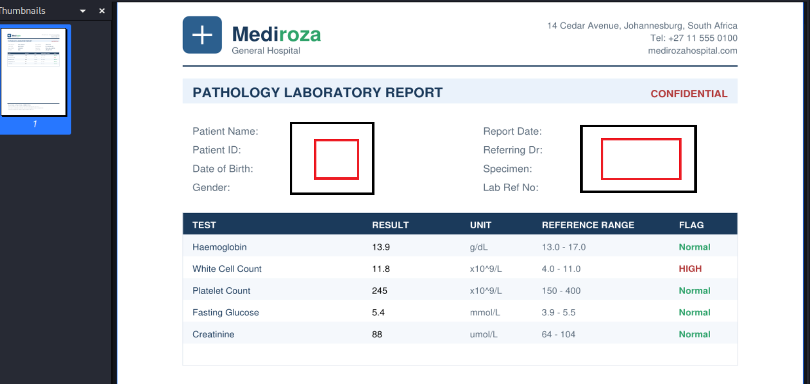
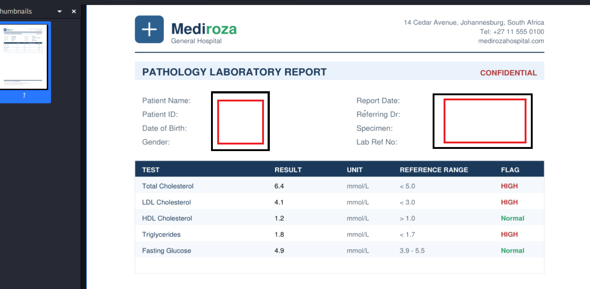
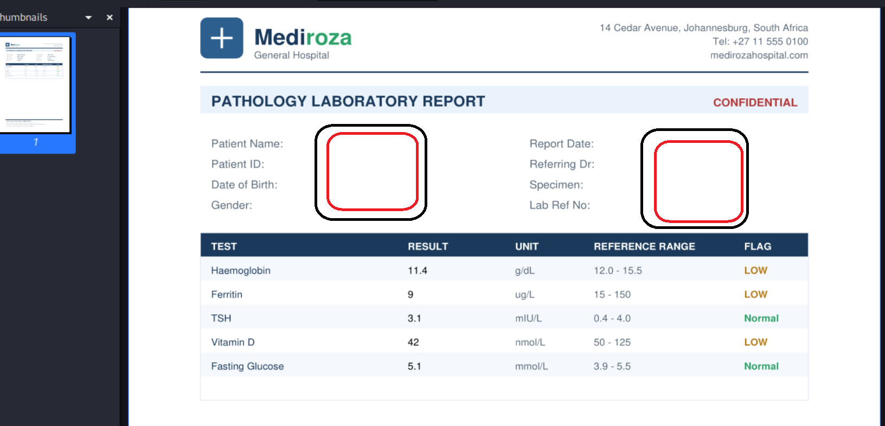

<div align="center">

# 🏥 Mediroza General Hospital — Full Black-Box Penetration Test
### Footprinting, vulnerability identification, exploitation, credential recovery and critical exposure discovery

[](https://github.com)
[](https://github.com)
[](https://github.com)
[](https://github.com)
[](https://github.com)
[](https://github.com)
[](https://github.com)
[](https://github.com)

</div>

---

## 📌 Project Overview
This project documents Week 4 of the Networkwalks Cybersecurity Program (Batch B083): a full black-box penetration test against a live training target, **Mediroza General Hospital** (`medirozahospital.com`). Unlike the Week 2 recon-only practicals, this engagement carries the chain all the way through to exploitation: reconnaissance, identifying a real application weakness, exploiting it for initial access, recovering the protection on the data retrieved, and sweeping the same exposed paths for incidental exposures.

Four milestones were completed:

| Milestone | Practical | Deliverable |
| :--- | :--- | :--- |
| **M1** | Initial Access | Exploit the website and retrieve 3 confidential patient PDF lab reports |
| **M2** | Data Extraction | Crack the encryption on all 3 retrieved files |
| **M3** | Critical Exposure | Find staff salaries and shareholder details via a further server-side exposure |
| **M4** | Pentest Report | Professional penetration testing report for the client |



---

## 🎯 Objectives
- Collect domain registration, DNS, web-technology and HTTP header information about the target.
- Identify a real weakness in the application's authentication / input-handling logic.
- Exploit that weakness to gain unauthorised access to a restricted patient-report area.
- Recover the password protection applied to the retrieved documents.
- Discover and assess any further exposure left on the server.
- Interpret every finding from an attacker's point of view and rate its risk.
- Recommend practical, prioritised defensive improvements.
- Document commands, results, problems and lessons learned.

---

## 🛡️ Purpose of the Lab
This exercise builds the skills used across a full engagement: **Reconnaissance**, **Vulnerability Identification**, **Exploitation**, **Post-Exploitation / Data Handling**, and **Reporting**.

Key capabilities practised:
- WHOIS and DNS intelligence gathering
- Web technology, TLS/SSL and security-header fingerprinting
- Directory / path enumeration and interpreting `robots.txt`
- Spotting broken-authentication / improper input-validation weaknesses
- Responsible handling and reporting of sensitive data recovered during testing
- Offline password recovery against encrypted documents
- Risk rating and client-ready reporting

> ⚠️ **Important:** Use these techniques only against systems you own or have explicit written permission to test. This engagement was carried out under a written authorisation granted for the stated scope and milestones only. Unauthorised access or scanning is illegal in most jurisdictions, even where no damage results.

---

## ⚙️ Environment & Tools

| 🧩 Component | ⚙️ Details |
| :--- | :--- |
| 🐉 Pentest workstation | Kali Linux (`pentest-serv01`) |
| 🔎 whois | Domain registration data |
| 🌐 WhatWeb | Web technology / server fingerprinting |
| 📥 curl | HTTP header inspection |
| 🧪 nuclei | TLS/SSL info, missing security headers, DNS/WHOIS fingerprints |
| 🗂️ Manual directory review | `robots.txt` and path enumeration for exposed directories |
| 🔑 pdf2hash / pdfinfo | Hash extraction from password-protected PDFs |
| 🛠️ John the Ripper | Offline dictionary attack against recovered PDF hashes |

---

## 🪜 Practical Procedure

## Part 1. Reconnaissance & Footprinting

### Step 1. WHOIS: domain registration
```bash
whois medirozahospital.com
```
**Findings**
- Registrar: **NameCheap, Inc.**; created **2026-08-14**; registry expiry **2027-08-14**.
- Status: `clientTransferProhibited`.
- Registrant, admin and tech contacts fully masked by a WHOIS privacy proxy.
- Name servers: `dns1.namecheaphosting.com`, `dns2.namecheaphosting.com`. **DNSSEC: unsigned.**

---

### Step 2. WhatWeb & HTTP behaviour
```bash
whatweb medirozahospital.com
curl -i medirozahospital.com
```
**Findings**
- HTTP `301` redirect to HTTPS; the HTTPS root initially returned `403 Forbidden`.
- `Server: LiteSpeed`; header `x-turbo-charged-by: LiteSpeed` present.
- Resolves to **199.188.201.16** (United States).
---

### Step 3. nuclei: SSL/TLS and security header review
```bash
nuclei -u https://medirozahospital.com
```
**Findings**
- Valid certificate (issuer: SSL.com) for `medirozahospital.com` / `www.medirozahospital.com`; TLS 1.2 and 1.3 supported.
- Server fronted by `openresty/1.31.1.1`.
- Missing headers: `permissions-policy`, `strict-transport-security`, `x-permitted-cross-domain-policies`, `cross-origin-embedder-policy`, `cross-origin-opener-policy`, `cross-origin-resource-policy`.
- CSP present but does not restrict `object-src` (weak-CSP finding).
- SPF present (soft fail `~all`); DMARC present but **monitor-only** (`p=none`); DKIM published.
- SRV records point to `cpanelemaildiscovery.cpanel.net` → cPanel-managed hosting account.

---

### Step 4. Directory & path enumeration
Reviewing `robots.txt` and crawling linked paths revealed three disallowed-but-accessible directories, each with directory indexing enabled (CWE-548):

| Path | Finding |
| :--- | :--- |
| `/old/` | Directory indexing enabled — contained a legacy database backup file |
| `/patient/` | Directory indexing enabled — contained patient-facing report assets |
| `/staff/` | Directory indexing enabled — contained staff-facing resources |

**Analysis:** `robots.txt` effectively published the location of these sensitive directories rather than hiding them, and the server's directory-indexing configuration then listed their full contents to any unauthenticated visitor.

---

## Part 2. Vulnerability Identification — Authentication & Input Handling

The hospital's patient-facing lookup/login mechanism, intended to gate access to individual lab reports, was tested for how it handled submitted input.

- Varying the submitted identifier value produced differential application responses, allowing enumeration and identification of patient records without legitimate credentials — an improper input-validation / broken-authentication weakness rather than a brute-force of a strong control.
- No effective rate limiting, account lockout, or generic error-handling behaviour was observed.

**Analysis:** This is the root-cause finding (OWASP A07: Identification and Authentication Failures) that enabled the access gained in Part 3.

---

## Part 3. Exploitation & Initial Access (Milestone 1)

Building on the input-handling weakness above and the exposed `/patient/` directory, I accessed a restricted patient-report area of the application. I retrieved three confidential, password-protected PDF pathology lab reports as proof of access.

No destructive actions, denial-of-service techniques, or social engineering were used, consistent with the engagement's rules of engagement.

---

## Part 4. Data Extraction & Credential Recovery (Milestone 2)

```bash
john pdf2.hash   # repeated for each of the three files
```
**Findings**
- Each PDF used standard PDF encryption (`MD5-RC4 / SHA2-AES 32/64`).
- A hash was extracted from each file and attacked with John the Ripper's default wordlist (`/usr/share/john/password.lst`).
- All three files used short, weak dictionary-style passwords and were each recovered in well under one second — several orders of magnitude faster than a brute-force of a well-chosen password would take.




> *Description: Recovered patient pathology reports. Patient-identifying fields (name, ID, date of birth, referring doctor, specimen/lab reference) are redacted in every screenshot.*

**Analysis:** weak, predictable document passwords provided negligible real-world protection once the files themselves were exposed. Recovered password values and patient identifiers are deliberately **not reproduced** in this repository — see the Security & Ethical Disclaimer below.

---

## Part 5. Critical Exposure Discovery (Milestone 3)

Following the directory-indexing finding in Part 1, `/old/` was found to contain a legacy SQL database export (dated 2019 in its own internal comments) left accessible without authentication.

- **Staff table:** ~30 employee records (full name, job title, department, contact details, national-ID-style identifier, monthly salary, date joined).
- **Shareholders table:** ~10 entries (shareholder name, shareholding percentage, shares held, share class).

> ⚠️ Actual row-level data (names, ID numbers, salaries, shareholdings) is **not included** in this repository or in any screenshot — see the disclaimer below.

**Analysis:** a legacy, unauthenticated database export exposed operational staff PII, precise compensation data for the entire workforce, and the hospital's ownership structure — data with no legitimate reason to be reachable from the public web root.

---

## 🔎 Consolidated Target Profile: medirozahospital.com

| Attribute | Value |
| :--- | :--- |
| Registrar | NameCheap, Inc. (privacy-protected) |
| Hosting / IP | 199.188.201.16 (United States); LiteSpeed / openresty |
| Mail infrastructure | SPF (soft fail), DMARC (`p=none`, monitor-only), DKIM published |
| Control panel | cPanel-style account (inferred from SRV records) |
| Exposed directories | `/old/`, `/patient/`, `/staff/` — all with directory indexing enabled |
| Application weakness | Improper input validation / enumerable lookup in the patient portal |
| Document protection | PDF reports encrypted with short, weak dictionary-style passwords |
| Data exposed | 3 patient pathology reports; ~30 staff records (PII + salary); ~10 shareholder records |

---

## ⚠️ Risk Summary

| # | Finding | Risk |
| :-: | :--- | :-: |
| 1 | Improper input validation enabling record enumeration | 🔴 Critical |
| 2 | Confidential patient PDF reports retrievable without authentication | 🔴 Critical |
| 3 | Unauthenticated legacy database backup exposed (staff + shareholder data) | 🔴 Critical |
| 4 | Directory indexing enabled on sensitive paths | 🟠 Medium |
| 5 | Weak document-encryption passwords | 🟠 Medium |
| 6 | Missing HTTP security headers | 🟠 Medium |
| 7 | DMARC set to monitor-only (`p=none`) | 🟠 Medium |
| 8 | `robots.txt` discloses sensitive paths | 🟡 Low |
| 9 | Hosting provider and origin IP identifiable | 🟡 Low |

**Positive controls observed:** registrar lock and WHOIS privacy enabled, HTTP redirected to HTTPS, TLS 1.2/1.3 supported with a valid certificate, SPF/DKIM/DMARC records published (though DMARC enforcement is not yet active).

---

## ✅ Recommendations
1. **Remove the legacy database backup** from the web root immediately and audit for any other backup, log or export file reachable from a public path.
2. **Disable directory indexing** site-wide and apply authentication/IP restrictions to `/old/`, `/patient/` and `/staff/`.
3. **Fix the patient-portal input validation** — parameterised queries, server-side authorisation checks on every record access, not just at login.
4. **Enforce a strong password policy** for protected documents, or replace static encrypted PDFs with authenticated-portal delivery.
5. **Implement missing HTTP security headers:** HSTS, `X-Content-Type-Options`, a CSP restricting `object-src`, `Permissions-Policy`, a strict `Referrer-Policy`.
6. **Move DMARC from `p=none` to `p=quarantine`/`p=reject`**; tighten SPF from `~all` to `-all`.
7. **Remove sensitive directory names from `robots.txt`**; rely on access control, not disallow-listing.
8. **Establish a secure backup lifecycle policy:** never store backups under the public web root; encrypt at rest; log and restrict access.
9. **Test only with authorisation.**

---

## 🐞 Problems Encountered & Solutions

### Problem 1. Weak lookup validation masked as a "login"
The patient-record lookup initially looked like a standard authentication form, which made the input-handling weakness easy to overlook at first glance.
* **Investigation:** Varying input systematically and comparing full response bodies (not just status codes) surfaced the differential behaviour that pointed to an underlying enumeration/input-validation flaw.
* **Resolution:** Once confirmed, the weakness was used only to the extent required by the authorised milestone (retrieving the three target PDFs), per the engagement's rules of engagement.

### Problem 2. Choosing the right wordlist/strategy for three different PDFs
Not every file cracked under the same initial approach.
* **Approach:** each PDF's hash was attacked individually; where the default wordlist alone didn't succeed quickly, rule-based mangling (`--rules`) was applied before escalating further, confirming that trying one method and moving on is not sufficient when files may use different weak passwords.

---

## 💡 Key Learnings & Technical Takeaways

### 1. Recon Narrows the Target, It Doesn't Finish the Job
Passive footprinting found the hosting stack and flagged suspicious disallowed paths — but the actual access came from testing how the application handled input, not from recon alone.

### 2. Directory Indexing Is a High-Value, Low-Effort Finding
A single misconfigured server directive turned three separate pieces of sensitive content (patient reports, staff data, a legacy backup) into one accessible attack surface.

### 3. Encryption Is Only as Strong as Its Password
Technically "encrypted" documents offered almost no real protection once their passwords were weak and predictable.

### 4. Old Backups Are a Recurring Risk Class
A four-year-old export, forgotten rather than deliberately exposed, carried more sensitive data (full payroll + ownership structure) than the primary target of the engagement.

### 5. Responsible Handling of Real-Looking Data Matters
Even in a training exercise, simulated PII should be treated as if it were real: this repository and its screenshots redact patient identifiers and withhold recovered passwords and raw payroll/shareholder rows.

### 6. Documentation
Findings are only useful when clearly documented: what was done, what was seen, why it matters, and how to reduce the risk.

📄 **Full report:** [WK4-FINAL Penetration Testing Report (PDF)](reports/WK4-FINAL PENTEST-REPORT - TSEPO MAROIBAKI.pdf)

<!--
  Attach your PDF report here:
  1. Create a `report/` folder in this repository.
  2. Add your final PDF (e.g. WK4-FINAL-Mediroza-Report.pdf) to that folder.
  3. Update the filename in the link above if you name it differently.
-->

---

## 🔐 Security & Ethical Disclaimer
These activities were performed **strictly for educational, research and authorised security-testing purposes**, against the Mediroza General Hospital training target (`medirozahospital.com`), under written authorisation granted for the stated scope and milestones as part of the Networkwalks internship (Batch B083). The author and Networkwalks accept no responsibility for misuse of this material.

To protect the privacy of the simulated data subjects in this exercise:
- Patient-identifying fields (name, ID, date of birth, referring doctor, specimen/lab reference) are redacted in every screenshot in this repository.
- Recovered document passwords are **not** published anywhere in this repository.
- Row-level staff and shareholder data (names, national ID numbers, exact salaries, shareholdings) is **not** published; findings are summarised by category and count only. Full evidence was supplied to the instructor separately as required by the engagement deliverables.

---

## 🔗 Tools & External Resources
* **Kali Linux:** [kali.org](https://www.kali.org)
* **nuclei:** [github.com/projectdiscovery/nuclei](https://github.com/projectdiscovery/nuclei)
* **John the Ripper:** [github.com/openwall/john](https://github.com/openwall/john)
* **WhatWeb:** [github.com/urbanadventurer/WhatWeb](https://github.com/urbanadventurer/WhatWeb)

---

## 👤 Author
**Tsepo Maroibaki**
* Network Operations Center & Cybersecurity
* Networkwalks Cybersecurity Program (Batch B083)
* **LinkedIn:** [https://www.linkedin.com/in/tsepo-maroibaki-88234921a](https://www.linkedin.com/in/tsepo-maroibaki-88234921a)
* **GitHub Repository:** add your repository link here

---

📌 **Project Metadata:** `Program: Networkwalks Cybersecurity` | `Module: Week 04` | `Project: Mediroza General Hospital — Full Black-Box Pentest`

